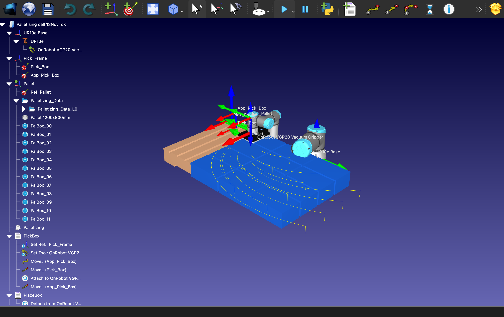
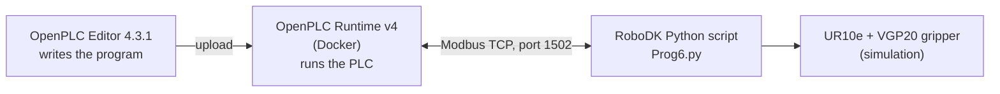
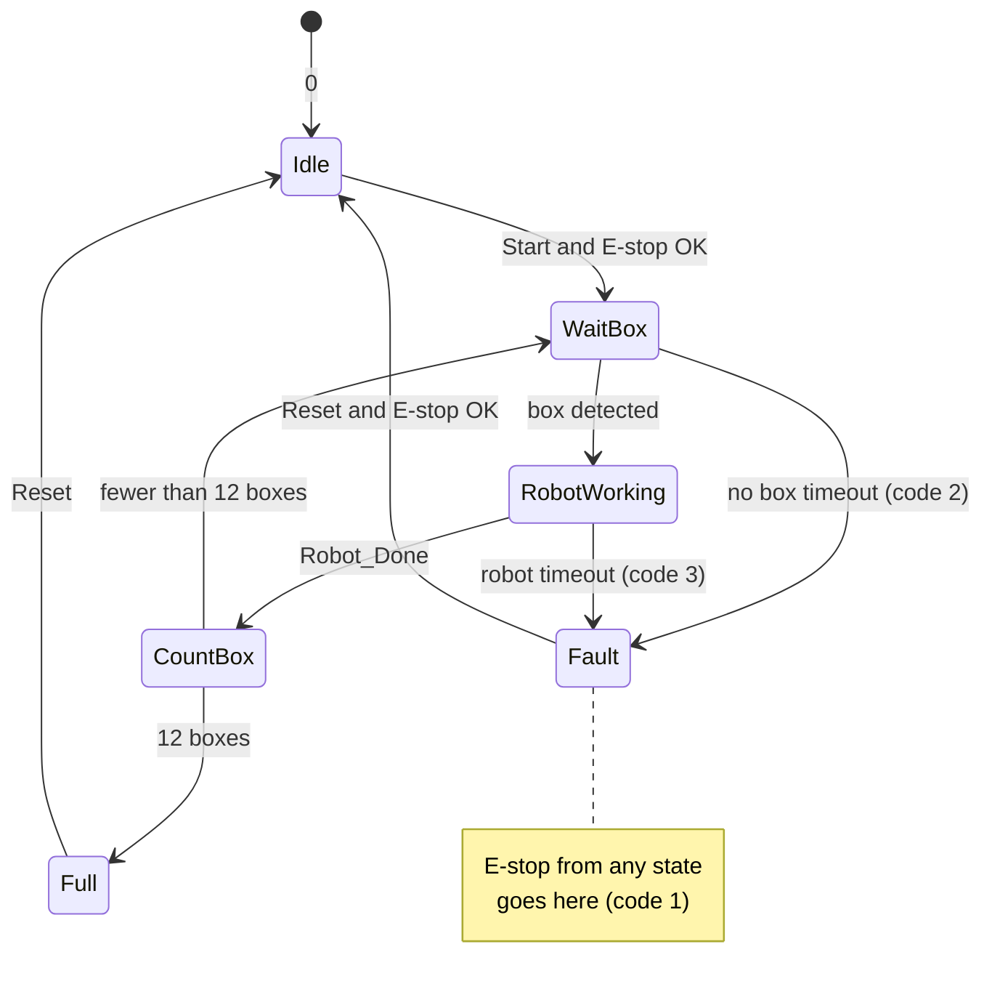
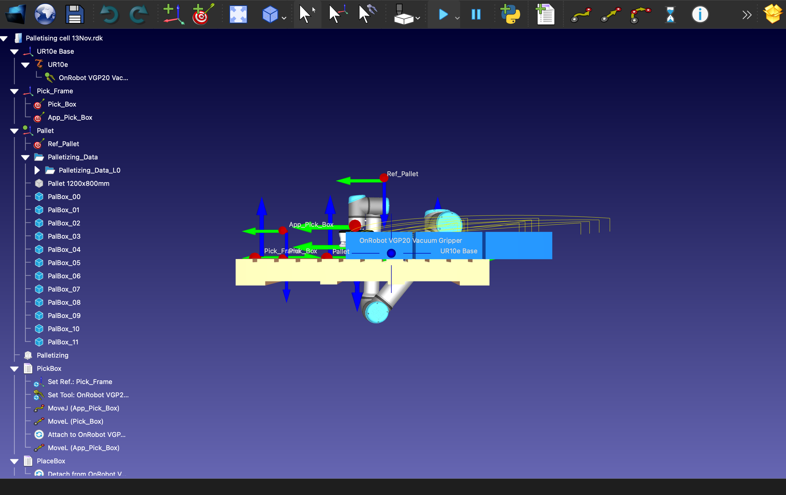
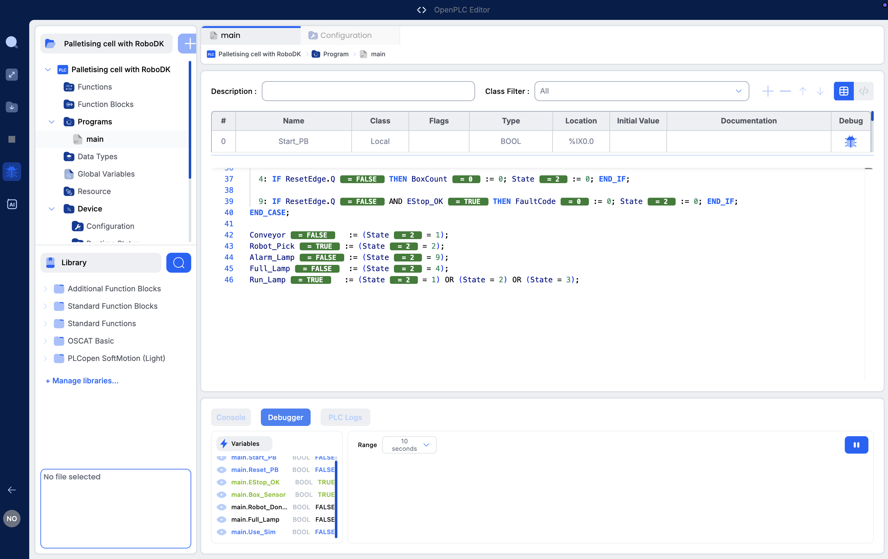

# Palletising Cell: OpenPLC and RoboDK


A PLC-controlled palletising cell, **designed and tested in simulation**.
An OpenPLC program runs the cell logic (state machine, E-stop, timeouts, fault codes).
A Python script in RoboDK moves a simulated UR10e robot. The two talk over **Modbus TCP**.

**Demo video (52 s):**
https://github.com/HarjotKaur-2911/palletising-cell-plc-robodk/issues/1#issue-6395499701



## Highlights

- The PLC drives the robot simulation end to end and places **all 12 boxes** on the pallet (4 x 3 grid).
- Request and done handshake between the PLC and the robot over Modbus TCP (port 1502).
- E-stop that overrides everything, a no-box timeout and a robot timeout, each with its own fault code.
- A reach check in the RoboDK script, so the robot never moves to a spot it cannot reach.
- PLC runs on a real OpenPLC Runtime v4 (Docker), not only in the editor's simulator.

## How it fits together



## PLC state machine



States in the program: 0 idle, 1 wait for box (conveyor on), 2 robot working, 3 count box, 4 full, 9 fault.

## Modbus interface

| Signal | Direction | PLC address | Modbus coil |
|---|---|---|---|
| `Robot_Pick` | PLC to RoboDK | `%QX0.1` | 1 |
| `Robot_Done_In` | RoboDK to PLC | `%QX1.0` | 8 |

`Robot_Done_In` is a coil (`%QX`), not an input (`%IX`), because a Modbus client cannot write to input addresses.
The coil numbers were confirmed with test scripts.

Fault codes: **1** = E-stop, **2** = no box, **3** = robot timeout.

## Cell details

- Robot: UR10e with an OnRobot VGP20 vacuum gripper (RoboDK simulation)
- Boxes: 178 x 305 x 125 mm, 4 x 3 grid, 15 mm gap
- Pallet: 1200 x 800 mm
- `PALLET_H = 0.0` (the pallet top is at the Pallet frame, checked from the front view)



## Repository contents

| File | What it is |
|---|---|
| `plc` | OpenPLC Editor project (Structured Text) |
| `Palletising cell 13Nov.rdk` | RoboDK station |
| `Prog6.py` | The RoboDK script that talks to the PLC |
| `Palletising Cell PLC Control of a Simulated Robot` (PDF) | Project report |
| `pallet-12-boxes.png`, `front-view.png`, `debugger-handshake.png` | Screenshots used in this README |

## How to run it

You need: RoboDK, OpenPLC Editor 4.3.1, Docker Desktop, and `pymodbus` inside RoboDK's Python
(the script tries to install it the first time).

1. **Start the PLC runtime** (first time only, then use `docker start openplc-runtime`):
   ```
   docker run -d --name openplc-runtime \
     -p 8443:8443 -p 1502:1502 \
     --cap-add=SYS_NICE --cap-add=SYS_RESOURCE \
     -v openplc-runtime-data:/var/run/runtime \
     ghcr.io/autonomy-logic/openplc-runtime:latest
   ```
2. In OpenPLC Editor, open the project in `plc`. Set the Device to **OpenPLC Runtime v4**, IP `127.0.0.1`, and click **Connect**
   (the first time you create a user). The Modbus server must be enabled on port **1502**.
3. Check that `Use_Sim` has the initial value **FALSE**. Build and upload the program, then press Play.
4. In the Debugger, set `EStop_OK` and `Box_Sensor` to TRUE, then pulse `Reset_PB`.
5. In RoboDK, open the station. Make sure `DRY_RUN = False` in `Prog6.py`, then run the script **first**.
   The bottom bar should say "Palletize v6.2 (PLC) running".
6. In the Debugger, pulse `Start_PB`.
7. Expected result: 12 boxes on the pallet, and the message "Done: 12 boxes placed with the PLC".

Setting `DRY_RUN = True` runs only the box placement, with no PLC, for checking positions.



## Testing

**Tested**
- PLC logic with the built-in simulated robot (`Use_Sim = TRUE`)
- Modbus link: coil numbers checked with test scripts
- Full PLC and RoboDK handshake for all 12 boxes
- Box positions and height on the pallet, checked from the front view

**Not yet verified**
- E-stop in the middle of a cycle, and the robot timeout, with the PLC driving the robot
- Real cycle time (the timeout values are not tuned)
- Behaviour on a real robot. This project is simulation only.

## Engineering challenges and fixes

| Problem | What was done |
|---|---|
| RoboDK's Palletizing helper made unreachable targets | Stopped using it and wrote my own script with a reach check |
| The robot spun in circles when a box was out of reach | Reach check before any move, one clean try per box, stop at the first problem |
| RoboDK kept running an old stored copy of the script | Added a version message in the status bar to prove which version runs |
| Boxes floated 144 mm above the pallet | Found the wrong `PALLET_H` from the front view, set it to 0 |
| Boxes were created but never moved to the pallet (the attach call did not attach) | v6.2 attaches the box directly to the gripper and releases it onto the Pallet frame |
| RoboDK could not write `Robot_Done_In` (it was an input address) | Moved it to a coil address (`%QX1.0`) |
| Dropped Modbus connections | The script reconnects on every call |
| A short `Robot_Pick` pulse was missed | The PLC now waits for the done signal to clear |
| Box count was off (11 instead of 12) | `BoxCount` resets on Start, and the script starts before Start is pressed (this is my best reading of the cause, not proven) |

## Skills shown

PLC programming (Structured Text), state-machine design, fault handling, Modbus TCP, robot simulation and Python scripting in RoboDK, Docker, debugging and testing.

## Notes

- Docker stops when the Mac sleeps. If the editor says "Connection failed", run `docker start openplc-runtime` and connect again.
- RoboDK runs its own stored copy of a script. If a change seems to have no effect, check which file RoboDK is really running.
